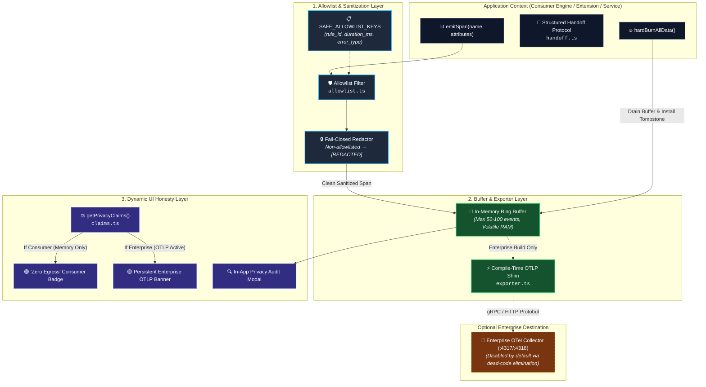
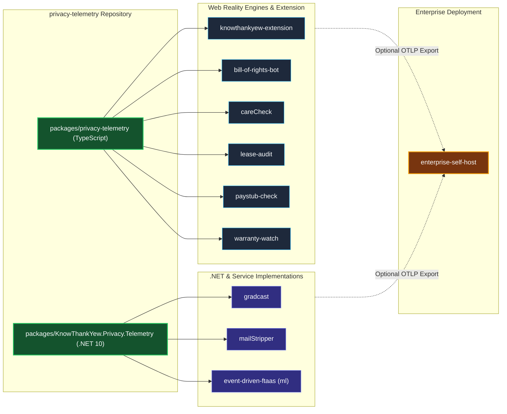

<!-- diagram-meta
  last-validated: 2026-10-26
  validated-commit: b284e67
  covers: [packages/**]
  generated-by: manual
-->

# Architecture & Invariants Specification: Privacy Telemetry Framework

> Cross-platform telemetry foundation (.NET 10 & TypeScript/React) enforcing the 5 Core Invariants across the `knowthankyew` portfolio.

---

## 1. Executive Summary

`privacy-telemetry` provides the universal telemetry abstraction used by every repository in the `knowthankyew` portfolio. Available as both an npm package (`@knowthankyew/privacy-telemetry`) and a .NET 10 NuGet package (`KnowThankYew.Privacy.Telemetry`), it guarantees that consumer applications operate with zero external telemetry egress by default, sanitizes all spans against fail-closed key allowlists, maintains dynamic runtime honesty for UI claims, and coordinates the portfolio's amnesiac "Hard Burn" state purge.

---

## 2. System Architecture & Component Interactions

### A. Telemetry Processing Pipeline & Trust Boundaries



### B. Polyglot Architecture & Ecosystem Distribution



---

## 3. Core Architectural Invariants

| # | Invariant | Description & Enforcement |
|:--|:----------|:--------------------------|
| 1 | **Volatile Memory Default** | Spans are held strictly in an in-memory circular ring buffer; zero disk, database, or network transport in public consumer builds. |
| 2 | **Compile-Time Dead Code Over Runtime Flags** | OTLP network exporters are stripped at build time via bundler tree-shaking unless `VITE_OTEL_EXPORTER_OTLP_ENDPOINT` is present. |
| 3 | **Strict Key Allowlists Beat Denylists** | Any attribute key not explicitly present in `SAFE_ALLOWLIST_KEYS` is redacted to `[REDACTED_BY_DEFAULT_ALLOWLIST]`. |
| 4 | **Single Source of Truth for Honest UI** | `getPrivacyClaims()` evaluates active runtime telemetry modes and dynamically forces UI badges (suppressing false "Zero Egress" claims in enterprise deployments). |
| 5 | **Nuclear Amnesia Purge** | A single invocation of `hardBurnAllData()` drains ring buffers, resets tombstone state, and broadcasts cleanup across active contexts. |

---

## 4. Directory Structure

```
privacy-telemetry/
├── PRIVACY_TELEMETRY_SCHEMA.md  # Portfolio-wide JSON/OTel schema contract
├── packages/
│   ├── privacy-telemetry/       # TypeScript / React npm package
│   │   ├── src/
│   │   │   ├── allowlist.ts     # SAFE_ALLOWLIST_KEYS & attribute redactor
│   │   │   ├── claims.ts        # getPrivacyClaims() dynamic truth engine
│   │   │   ├── exporter.ts      # Compile-time conditional OTLP exporter
│   │   │   ├── handoff.ts       # Structured Handoff protocol for deep links
│   │   │   ├── manager.ts       # TelemetryManager singleton & circular buffer
│   │   │   ├── react/           # React hooks, Context & PrivacyClaimsProvider
│   │   │   └── types.ts         # Telemetry span, claim, and audit types
│   │   ├── tests/               # Vitest unit & invariant suites
│   │   └── vite.config.ts       # Library build configuration
│   └── KnowThankYew.Privacy.Telemetry/ # .NET 10 NuGet package
│       ├── Abstractions/        # IPrivacyTelemetry, ITelemetrySanitizer
│       ├── Configuration/       # PrivacyOptions & OTLP endpoints
│       ├── Core/                # VolatileMemoryBuffer & sanitizer
│       ├── Extensions/         # IServiceCollection dependency injection
│       └── OpenTelemetry/       # ActivitySource & OTel SDK integration
└── tests/                       # Cross-ecosystem integration tests
```
